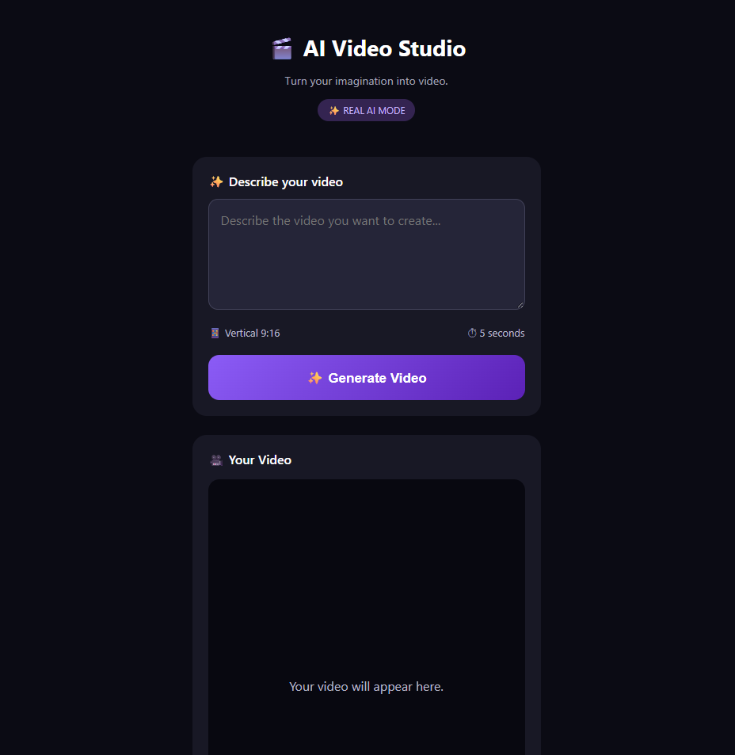

# 🎬 AI Video Studio


## 📱 Application Preview




### AI-Powered Text-to-Video Generation Platform

**AI Video Studio** is a full-stack web application that transforms natural-language prompts into AI-generated videos using the Runway API.

Built with Python, Flask, JavaScript, HTML, CSS, and SQLite, the application provides a mobile-responsive interface for generating, viewing, downloading, and managing AI video creations.

The project began as a prototype using sample videos and evolved into a working AI-powered application capable of submitting real video-generation requests, monitoring their progress, and displaying completed results.

## 🚀 Project Highlights

- **Real AI Video Generation:** Integrates Runway's Gen-4.5 text-to-video model to generate videos from user prompts.
- **Asynchronous Task Monitoring:** Polls the Runway API to track video generation status.
- **Personal Video Gallery:** Stores generation history and displays completed videos.
- **Video Management:** Supports deleting individual gallery records.
- **Download Functionality:** Provides a download action for generated videos.
- **Mobile-Responsive Design:** Designed for desktop and iPhone browsers, including Home Screen access.
- **Demo and Real AI Modes:** Allows interface testing without consuming API credits.
- **Error Handling:** Handles API errors, failed generation tasks, and content moderation responses.

## 🛠️ Technology Stack

| Technology | Purpose |
|---|---|
| Python | Backend application logic |
| Flask | Web framework and REST API |
| Runway API | AI-powered video generation |
| JavaScript | Frontend interactions and asynchronous requests |
| HTML5 | Application structure and video playback |
| CSS3 | Responsive interface and visual styling |
| SQLite | Video history and metadata storage |
| python-dotenv | Environment configuration |
| Git & GitHub | Version control and project hosting |

## 🧠 How It Works

1. The user enters a natural-language video prompt.
2. The Flask backend validates the request.
3. The application submits the prompt to Runway's text-to-video API.
4. Runway returns a unique generation task ID.
5. The frontend periodically checks the task status.
6. Once generation succeeds, the video is displayed in the built-in player.
7. The application updates the SQLite database with the completed generation.
8. The video becomes accessible through the My Creations gallery.

**Application workflow:**

```text
User Prompt
    |
    v
HTML / JavaScript Interface
    |
    v
Python Flask Backend
    |
    v
Runway AI API
    |
    v
Generation Task Monitoring
    |
    v
Generated Video
    |
    +----> Video Player
    |
    +----> SQLite Database
    |
    +----> My Creations Gallery
```

## ✨ Features

### 1. AI Text-to-Video Generation

Users can describe a scene using natural language and submit it for AI generation.

The application integrates with Runway's Gen-4.5 model and supports vertical video generation suitable for short-form content.

Generation duration is configured in the backend and is subject to the selected model's limits.

### 2. Generation Status Tracking

The application monitors generation tasks using status responses such as:

- `PENDING` — Waiting for processing.
- `RUNNING` — Video generation in progress.
- `SUCCEEDED` — Video generation completed.
- `FAILED` — Generation unsuccessful.

The frontend updates its display based on these responses.

### 3. My Creations Gallery

Generated video history is stored in SQLite, including:

- Unique task ID
- Original text prompt
- Video URL
- Generation status
- Generation mode
- Creation timestamp

The gallery automatically refreshes after successful generation.

### 4. Video Playback and Downloads

Completed videos can be viewed directly in the application's HTML5 video player.

A separate download action provides access to the generated video file, subject to browser behavior and the availability of the hosted video URL.

### 5. Video Deletion

Users can remove individual video records from the gallery through a dedicated Flask API endpoint.

A confirmation dialog helps prevent accidental deletion.

### 6. Demo Mode

Demo Mode allows developers to test the application's workflow using a sample video without making paid Runway generation requests.

Real AI Mode enables generation through the Runway API.

## 📁 Project Structure

```text
AI_video_Studio/
|
|-- app.py
|-- templates/
|   |-- index.html
|
|-- .env                 # Local configuration (not committed)
|-- .gitignore
|-- videos.db            # Local SQLite database
|-- .venv/               # Python virtual environment
```

## ⚙️ Local Installation

### Prerequisites

- Python 3.12 or a compatible Python version
- Runway Developer account
- Runway API key
- API credits for real video generation

### 1. Clone the Repository

```bash
git clone https://github.com/YOUR_USERNAME/AI-Video-Studio.git
cd AI-Video-Studio
```

Replace `YOUR_USERNAME` with the actual GitHub account name after publishing.

### 2. Create a Virtual Environment

```bash
python -m venv .venv
```

Activate it on Windows:

```powershell
.venv\Scripts\Activate.ps1
```

### 3. Install Dependencies

```bash
pip install Flask python-dotenv runwayml
```

### 4. Configure Environment Variables

Create a `.env` file in the project root:

```env
RUNWAYML_API_SECRET=your_runway_api_key
MOCK_MODE=true
```

Set `MOCK_MODE=false` when ready to use real Runway generation.

**Security:** Never commit API keys or the `.env` file to GitHub.

### 5. Start the Application

```bash
python app.py
```

Open:

```text
http://127.0.0.1:5000
```

The application is intended for local development at this stage.

## 🔌 REST API Endpoints

| Method | Endpoint | Description |
|---|---|---|
| GET | `/` | Application interface |
| GET | `/config` | Current generation mode |
| POST | `/generate` | Submit a video generation request |
| GET | `/status/<task_id>` | Retrieve generation status |
| GET | `/gallery` | Retrieve saved video history |
| DELETE | `/gallery/<video_id>` | Delete a saved gallery record |

## 🏆 Development Milestones

**Milestone 1 — Application Foundation**

Created the Python/Flask backend and responsive frontend interface.

**Milestone 2 — API Integration**

Connected the application to Runway's AI video generation service.

**Milestone 3 — Persistent Storage**

Implemented SQLite storage for video generation history.

**Milestone 4 — Video Management**

Added automatic gallery updates, playback, download controls, and record deletion.

**Milestone 5 — Real AI Generation**

Successfully generated and played an original AI video using a natural-language prompt through the Runway API.

**Milestone 6 — Error Diagnostics**

Implemented visibility into Runway generation failures, including content moderation error codes.

## 🗺️ Development Roadmap

The following features are planned and are not yet implemented:

- [ ] User-selectable video duration
- [ ] Extended video creation through clip continuation and stitching
- [ ] Image-to-video generation
- [ ] Video-to-video transformation
- [ ] Character replacement and performance features
- [ ] Improved reference-based visual consistency
- [ ] User authentication and private galleries
- [ ] Secure cloud deployment
- [ ] Subscription and credit-based billing
- [ ] API usage limits and cost controls
- [ ] Enhanced mobile experience

## 🔒 Security and Deployment

AI Video Studio is currently a development prototype.

Before public deployment, the application will require authentication, authorization, secure API key management, rate limiting, customer data isolation, and safeguards against unauthorized generation requests and credit consumption.

The Flask development server is not intended for public production hosting.

## 💡 What I Learned

Building AI Video Studio provided hands-on experience with:

- Full-stack web application development
- Integrating third-party AI APIs
- RESTful backend architecture
- Asynchronous JavaScript and API polling
- Database design and persistent storage
- Environment variables and credential management
- Error handling and API response debugging
- Responsive interface development
- Building and testing a functional AI-powered product

This project demonstrates how modern AI services can be integrated into practical applications using traditional software engineering tools.

## 🎯 Project Vision

The long-term goal of AI Video Studio is to provide an accessible creative platform where users can generate, customize, and manage AI-powered video content without needing advanced video editing or programming experience.

Future development will focus on greater creative control, improved video realism, character-based editing, and tools for short-form content creators.

## 👨‍💻 Author

**Verse**

Computer Engineering Student | Python Developer | Aspiring Software Engineer

Built as an independent software development project focused on artificial intelligence, full-stack engineering, and creative technology.

## 📄 License

No open-source license has been selected yet. All rights are reserved unless a license is added.

---

**AI Video Studio — Turning ideas into AI-generated video.**

*Powered by Runway. Runway API usage is subject to Runway's terms and content policies.*
